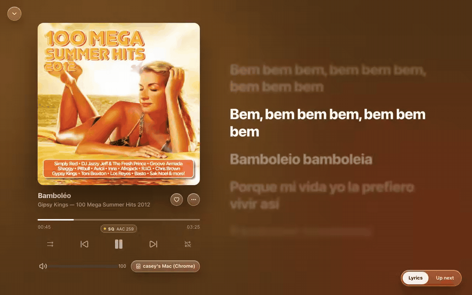
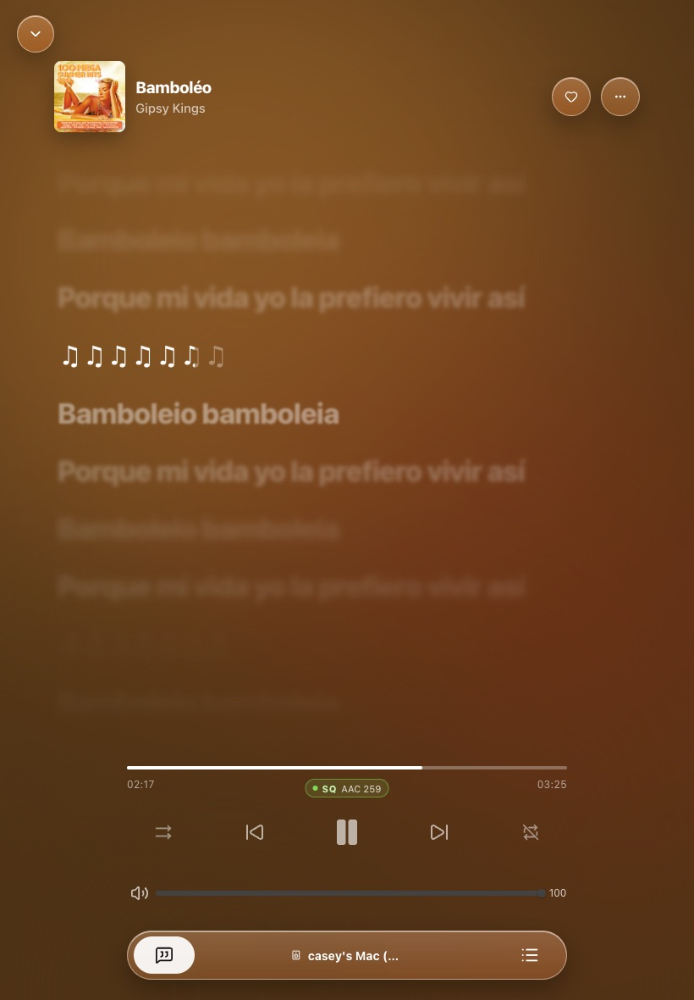
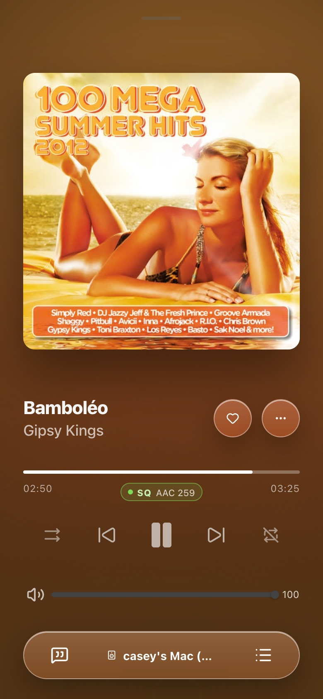
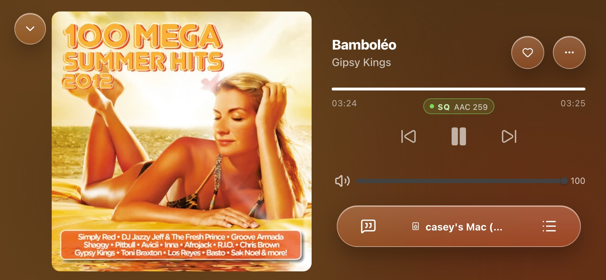
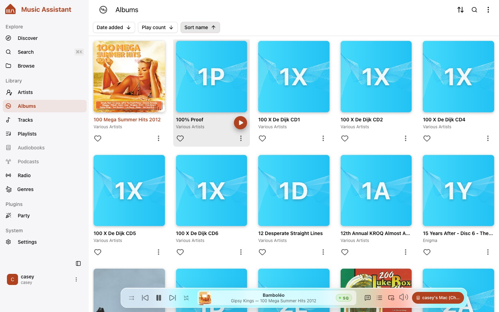
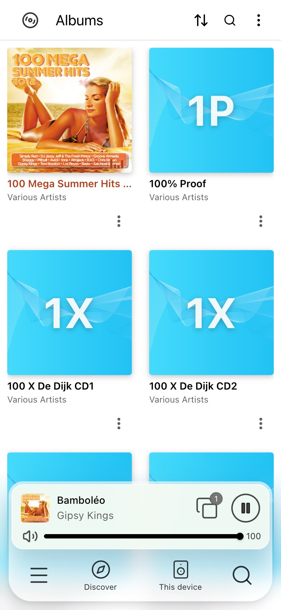
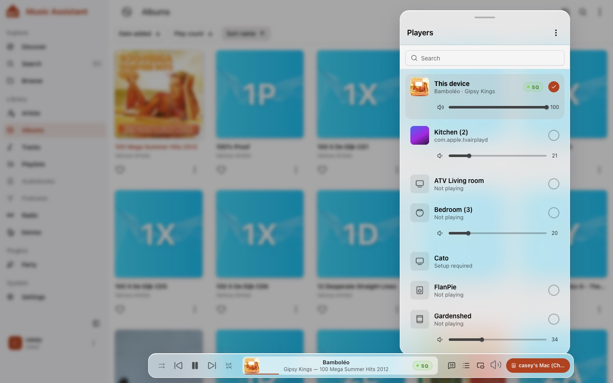
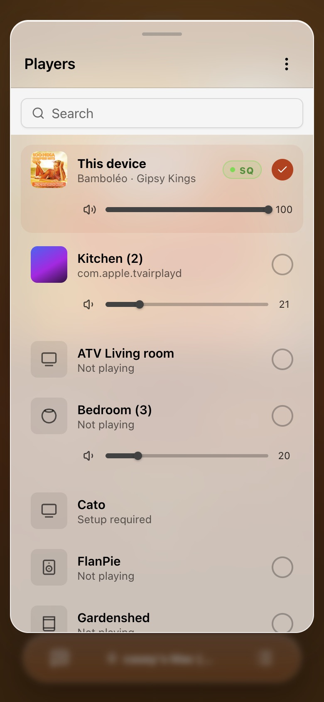
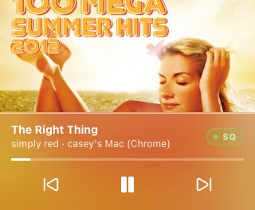

# amusic-assistant

**An Apple Music–style player for [Music Assistant](https://music-assistant.io).**

Music Assistant has become great at *what* it plays. This fork is about *how it feels* while it plays: artwork-tinted fullscreen with synced lyrics, a floating glass player bar, an always-on-top mini player and an AirPlay-style room picker. It runs against your existing Music Assistant server.



> **Status:** early, but used daily. Expect rough edges, and please report them.

[](https://buymeacoffee.com/caseyberlin)

---

## What's different

### Fullscreen now playing

A backdrop tinted by the artwork, big cover art, and lyrics or the queue beside it. The current lyric line is full contrast; the others fade and blur with distance, as in Apple Music. Tracks without artwork get a generated cover instead of a grey placeholder, and tracks without lyrics say so instead of showing an empty panel.

It is designed per screen shape rather than stretched from one layout:

| Layout | Decided by | What you get |
| --- | --- | --- |
| Desktop | wider than 1366px | Artwork and controls left, lyrics or queue right, bounded on ultra-wide screens |
| Tablet landscape | up to 1366px wide | The same two columns, sized so every control stays on screen |
| Tablet portrait | under 1000px wide | Artwork shrinks to a header when lyrics or the queue open; controls capped at 520px |
| Phone portrait | under 600px wide | One column with a glass dock for lyrics, room and queue |
| Phone landscape | under 500px tall | Artwork beside the controls, nothing scrolls |

The layout follows the screen's shape, not whether it has touch: on touch screens every control gets a 44px target either way. Resizing a window switches layout mid-song without interrupting playback.

| Desktop | Tablet landscape |
| --- | --- |
|  |  |

| Tablet portrait | Phone | Phone landscape |
| --- | --- | --- |
|  |  |  |

### Floating glass bar

On tablets and desktops the full-width bottom strip becomes a translucent pane floating over the content: transport on the left, a centre display with artwork, title, artist, album and a hairline of progress, and lyrics, queue, mini player, volume and room on the right. Volume grows in place into a slider, as in Apple Music. When the bar gets narrow it drops controls in order (shuffle and repeat first) and keeps play, title and room. On phones the floating player card gets the same glass.

### Accent from the artwork

The app's accent (logo, active navigation, buttons, progress) takes its colour from the playing track's artwork and eases to the next one when the track changes. It is adjusted until it meets WCAG AA contrast, and falls back to a warm coral when nothing is playing or the cover is mostly grey. Surfaces stay neutral white and grey (near-black in dark mode), and the app uses your platform's own typeface, with Inter bundled where there is none.

| Desktop library and glass bar | Phone library |
| --- | --- |
|  |  |

### Output picker

Choosing where music plays works like AirPlay: every room as a row with what it is playing, its stream-quality badge and its own volume slider. A checkmark marks the active room; a round toggle adds a compatible room to its group, or removes it again. A glass sheet on phones, a popover anchored to the room button elsewhere, with search from nine rooms.

| Desktop | Phone |
| --- | --- |
|  |  |

### Always-on-top mini player

A small window with the artwork, title, room, quality badge and controls that stays in front of your other apps. Each browser gets the best mechanism it has:

| Browser | Mini player |
| --- | --- |
| Chrome, Edge, Arc, Opera | A real always-on-top window (Document Picture-in-Picture) with working controls |
| Safari | A picture-in-picture window of the artwork and title; play and pause from the window, skip with the system media controls |
| Firefox, or any browser on plain `http://` | A small popup window, which cannot stay on top; a one-time hint says why |

Picture-in-picture needs a secure origin: `localhost` or HTTPS. Over plain HTTP, Chromium withholds it and you get the popup.



### Stream quality, everywhere

Music Assistant's quality tiers (LQ, SQ, HQ, Hi-Res) appear under the scrubber with the format (for example "SQ AAC 259"), in the bar, in the mini player and per room in the picker. Tapping the badge opens Music Assistant's own signal-path details.

---

## Getting started

### Requirements

- A Music Assistant **server 2.11 or newer** (API schema 86+). This fork tracks upstream `main`.
- Node 24 and pnpm (via corepack) to build it.

### Run it locally

```sh
pnpm install
pnpm dev
```

Open http://localhost:3000 and enter your Music Assistant server address when asked.

### Host it

```sh
pnpm build
```

This writes a static site to `music_assistant_frontend/`. Serve it from any static host. It asks for your server address on first load, so one build works for any server. Your server keeps serving the stock frontend at its own address; this one lives alongside it.

Or replace the frontend your server serves, so the usual server address opens amusic: mount the build over the server's bundled frontend with a read-only volume (`<build>:/app/venv/lib/python3.14/site-packages/music_assistant_frontend:ro` in the server container, Python version as in your image). [`scripts/deploy-amusic.sh`](scripts/deploy-amusic.sh) builds, checks that path and copies the build over SSH; remove the volume to get the stock UI back.

Browsers block an HTTPS page from talking to a plain `http://` server. Host it on HTTPS if your server is on HTTPS (for example behind `tailscale serve`), or on plain HTTP next to an HTTP server (picture-in-picture is then replaced by the popup).

---

## How the fork stays mergeable

This is a fork of [music-assistant/frontend](https://github.com/music-assistant/frontend). Music Assistant has no theme or plugin hook, so the player changes have to live in the code, but they are kept apart from it:

- Everything fork-specific lives in [`src/amusic/`](src/amusic/): components, composables, styles and their tests.
- Upstream files only get small mount points, each marked with an `amusic:` comment. List them with:

  ```sh
  git grep -n "amusic:" -- src ':!src/amusic'
  ```

- Upstream changes merge in the usual way:

  ```sh
  git remote add upstream https://github.com/music-assistant/frontend.git
  git fetch upstream && git merge upstream/main
  ```

- [`src/amusic/README.md`](src/amusic/README.md) lists the upstream components the fork re-uses, which are the ones to check when a merge breaks the type check.
- The work is planned as [OpenSpec](openspec/) changes, with requirements and scenarios for every surface above.

## Known gaps

- The mini player is verified in Chrome. Safari's and Firefox's versions are built but not yet tested in those browsers.
- Lyrics come from your server's lyrics provider; when it is rate limited, the panel falls back to the queue after 12 seconds.
- Tracks with plain (unsynced) lyrics have not been checked against the new lyrics styling yet.

## Credits

All credit for Music Assistant goes to its authors and contributors; this fork only reworks the player experience. Licensed under Apache 2.0, like upstream. Not affiliated with Apple or the Open Home Foundation.

If this is useful to you, [buy me a coffee](https://buymeacoffee.com/caseyberlin).

---

## Upstream development notes

The notes below come from the upstream frontend README.

The Music Assistant frontend/panel is developed in Vue, development instructions below.

## Recommended IDE Setup

[VSCode](https://code.visualstudio.com/) + [Volar](https://marketplace.visualstudio.com/items?itemName=johnsoncodehk.volar) (and disable Vetur) + [TypeScript Vue Plugin (Volar)](https://marketplace.visualstudio.com/items?itemName=johnsoncodehk.vscode-typescript-vue-plugin).

## Type Support for `.vue` Imports in TS

TypeScript cannot handle type information for `.vue` imports by default, so we replace the `tsc` CLI with `vue-tsc` for type checking. In editors, we need [TypeScript Vue Plugin (Volar)](https://marketplace.visualstudio.com/items?itemName=johnsoncodehk.vscode-typescript-vue-plugin) to make the TypeScript language service aware of `.vue` types.

If the standalone TypeScript plugin doesn't feel fast enough to you, Volar has also implemented a [Take Over Mode](https://github.com/johnsoncodehk/volar/discussions/471#discussioncomment-1361669) that is more performant. You can enable it by the following steps:

1. Disable the built-in TypeScript Extension
   1. Run `Extensions: Show Built-in Extensions` from VSCode's command palette
   2. Find `TypeScript and JavaScript Language Features`, right click and select `Disable (Workspace)`
2. Reload the VSCode window by running `Developer: Reload Window` from the command palette.

## Customize configuration

See [Vite Configuration Reference](https://vitejs.dev/config/).

## Project Setup

```sh
nvm use node
pnpm install
```

### Compile and Hot-Reload for Development

```sh
pnpm dev
```

This will launch an auto-reload development environment (usually at http://localhost:3000)
Open the url in the browser and a popup will ask the location of the MA server.
You can either connect to a locally launched dev server or an existing running server on port 8095.

### Type-Check, Compile and Minify for Production

```sh
pnpm build
```

### Lint with [ESLint](https://eslint.org/)

```sh
pnpm lint
```

## UI Framework

This project is migrating from **Vuetify** to **[shadcn-vue](https://www.shadcn-vue.com/)** as its primary UI component library.

## Development Guidelines

### Components

- **Size limit**: Keep components under 300–400 lines. If a component grows beyond this, split it into smaller, focused sub-components.
- **Single responsibility**: Each component should do one thing well. Extract repeated logic or UI patterns into reusable components.
- **Composition over complexity**: Prefer composing small components rather than building monolithic ones with many responsibilities.

### UI Components

- **Use shadcn-vue**: All new UI should use [shadcn-vue](https://www.shadcn-vue.com/) components located in `src/components/ui/`. Do not introduce new Vuetify components.
- **Extend, don't override**: If a shadcn-vue component needs customization, extend it via props or slots rather than overriding styles globally.
- **Avoid inline styles**: Use Tailwind utility classes for styling. Avoid `style=""` attributes except for dynamic values that cannot be expressed as classes.
- **Tailwind first**: Style with Tailwind utility classes rather than a scoped `<style>` block. Arbitrary values (`text-[44px]`) and variants (`max-md:`, `[&>.v-divider]:hidden`) cover most cases; keep scoped CSS for what Tailwind cannot express, such as keyframes or `:deep()` rules reaching into a child component.
- **Override utilities with utilities**: Every Tailwind utility is `!important` (`src/styles/style.css`), so scoped CSS cannot override one. Pass a competing utility instead; `cn()` (`src/lib/utils.ts`) drops the one it replaces.

### TypeScript

- **Always type props and emits**: Define explicit types for all component props and emits — avoid `any`.
- **Prefer `interface` for object shapes**: Use `interface` for defining data shapes and `type` for unions/intersections.
- **No implicit `any`**: Every function parameter and return value should be typed or clearly inferrable.

### State & Composables

- **Extract reusable logic into composables**: Any stateful logic shared between two or more components belongs in a `composable` under `src/composables/`.
- **Keep `<script setup>` lean**: Heavy logic (data fetching, transformations) should live in composables, not inline in the component.

### Helpers & Utilities

- **Pure functions go in `src/helpers/`**: Any standalone utility function (e.g. string manipulation, date formatting, data transformation) must be placed in `src/helpers/` rather than inlined in a component or composable.
- **One file per concern**: Group related helpers in a named file (e.g. `src/helpers/string.ts`, `src/helpers/date.ts`). Avoid a single catch-all `utils.ts`.
- **Test every helper**: Each helper file must be covered by unit tests. For new helpers, add a corresponding test file colocated with the helper (e.g. `src/helpers/string.test.ts`). Existing tests under `tests/helpers/` may remain, but new tests should follow the colocated pattern. Helpers with no test coverage should not be merged.

### API Calls & User Feedback

- **Always show feedback on API calls**: Every API call must be wrapped with user feedback:
  - On success: call `toast.success(...)` with a clear confirmation message.
  - On failure: call `toast.error(...)` with a meaningful error message — never silently swallow errors.
- **Example pattern**:
  ```ts
  try {
    await api.doSomething()
    toast.success("Action completed successfully")
  } catch (e) {
    toast.error("Failed to complete action")
  }
  ```
- **Do not use `console.error` as a substitute** for user-facing feedback on API errors (or for meaningful calls).

### General Best Practices

- **No magic numbers/strings**: Extract constants with descriptive names.
- **Meaningful naming**: Variables, functions, and components should clearly describe their purpose. Avoid abbreviations unless universally understood.
- **Keep templates readable**: If a template expression is complex, move it to a computed property.
- **Clean up side effects**: Always clean up event listeners and intervals in `onUnmounted`; manually created watchers outside component `setup` or manual effect scopes must also be cleaned up.
- **Accessibility**: Use semantic HTML elements and provide `aria-*` attributes where appropriate.

---

# Translation Management

We use Lokalise to manage the translation files for the Music Assistant frontend

[](https://lokalise.com)

### Contributing

If you wish to assist in translating Music Assistant into a language that it currently does not support, please see here https://music-assistant.io/help/lokalise/.

---

[](https://www.openhomefoundation.org/)
